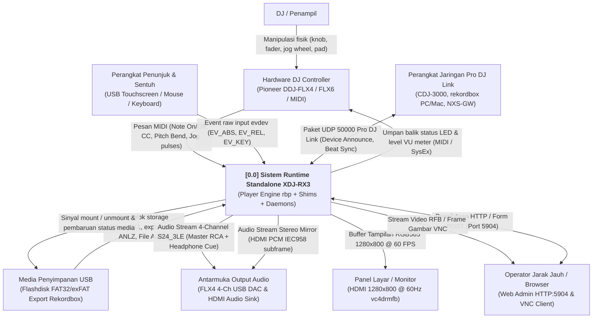
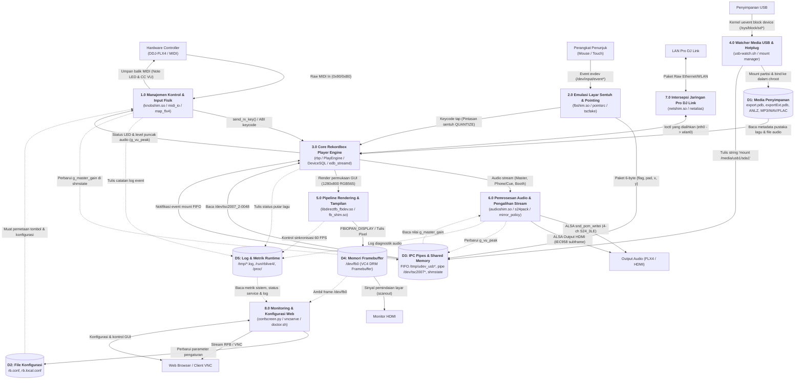
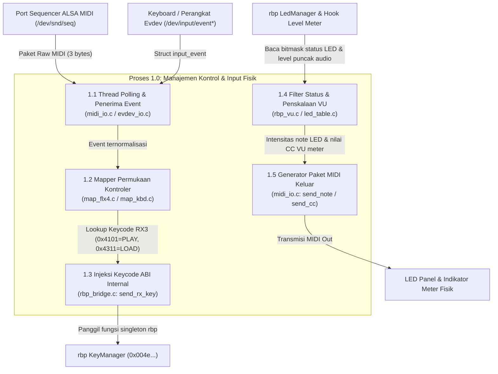
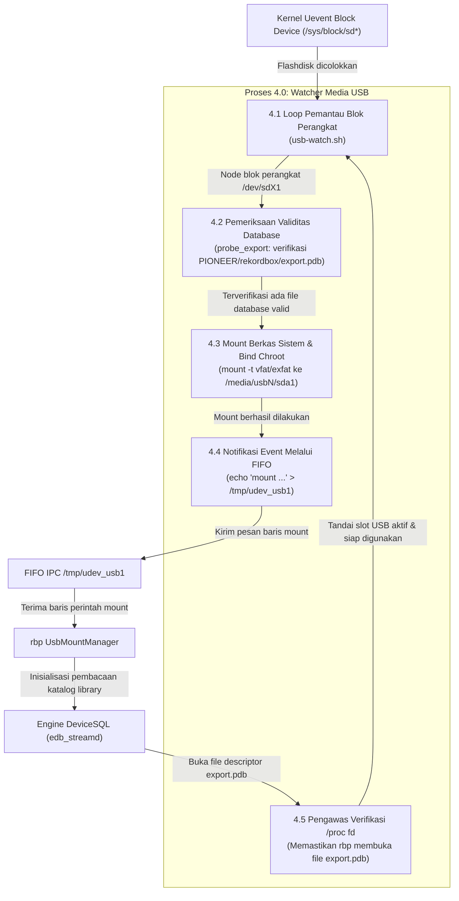
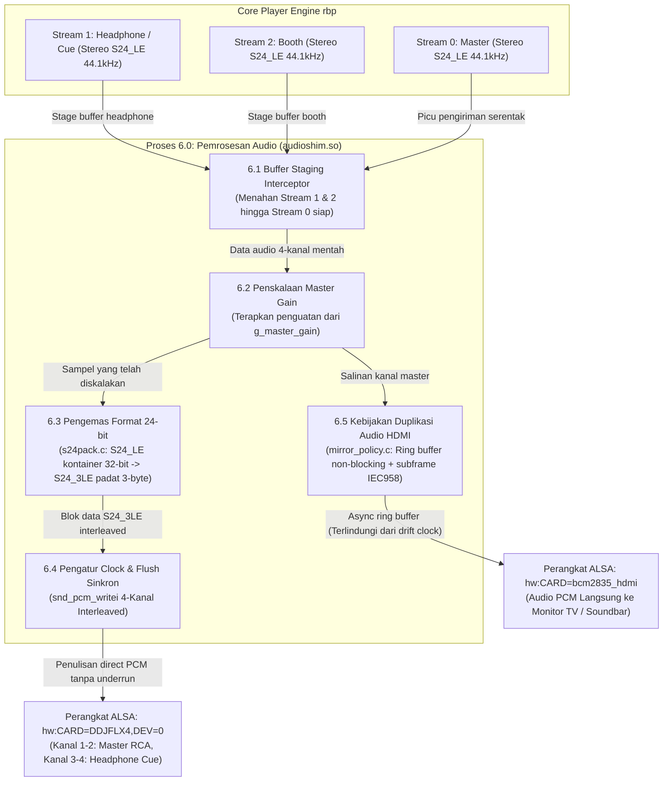
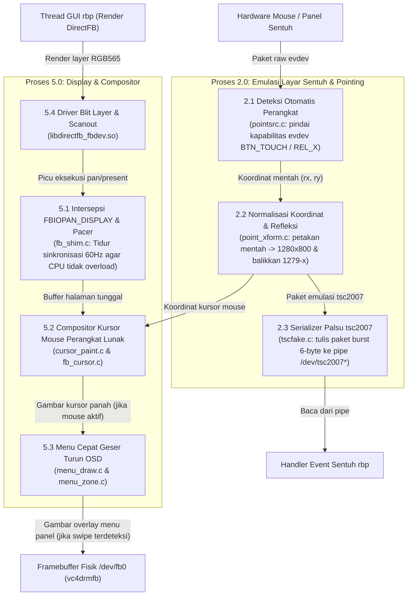

# 21 — Diagram Alir Data / Data Flow Diagram (DFD)

> *Versi Bahasa Inggris: [21-dfd-dataflow.md](21-dfd-dataflow.md)*

Dokumentasi lengkap Diagram Alir Data (Data Flow Diagram / DFD) untuk sistem runtime
standalone player Pioneer DJ XDJ-RX3 (`rbp`) pada platform Raspberry Pi 4B / Linux tertanam (embedded Linux).

Dokumen ini menjelaskan bagaimana data, sinyal kontrol, aliran audio (*audio streams*), dan input pengguna
mengalir di antara perangkat keras fisik, kernel Linux, pustaka *shim* ruang pengguna (*userspace* `LD_PRELOAD`),
daemon pembantu (*helper daemons*), serta biner asli ARM32 *soft-float* `rbp`.

---

## 1. DFD Level 0: Diagram Konteks (Context Diagram)

Diagram Konteks mendefinisikan batasan sistem untuk **Sistem Runtime Standalone XDJ-RX3**
serta interaksinya dengan entitas-entitas eksternal (DJ/penampil, perangkat kontrol fisik, media penyimpanan,
antarmuka audio DAC, monitor tampilan, rekan jaringan Pro DJ Link, dan manajemen jarak jauh).



---

## 2. DFD Level 1: Dekomposisi Sistem

DFD Level 1 memecah sistem utama menjadi 8 sub-proses fungsional dan 5 penyimpan data (*data stores*):

*   **1.0 Manajemen Kontrol & Input Fisik**: Menerjemahkan input MIDI dan evdev menjadi kode tombol (*keycode*) ABI internal `rbp`, serta menghasilkan sinyal umpan balik LED/VU.
*   **2.0 Emulasi Layar Sentuh & Pointing**: Menemukan perangkat penunjuk (*auto-discovery*), menormalisasi koordinat, dan mensimulasikan protokol kontroler resistif TI TSC2007.
*   **3.0 Core Rekordbox Player Engine**: Biner asli pemutar XDJ-RX3 ARM32 *soft-float* (`rbp`, `PlayEngine`, `DeviceSQL`, `edb_streamd`).
*   **4.0 Watcher Media USB & Manajemen Hotplug**: Mendeteksi penyematan USB, memvalidasi keberadaan database rekordbox, melakukan proses *mount*, dan memberi sinyal ke `rbp`.
*   **5.0 Pipeline Rendering & Tampilan**: Mengintersepsi ioctl framebuffer, menyediakan sinkronisasi *pacing* 60 Hz (*vblank*), dan menggabungkan overlay kursor serta menu cepat.
*   **6.0 Pemrosesan Audio & Pengalihan Stream**: Menangkap 3 stream stereo dari `rbp`, mengemas sampel 24-bit ke dalam frame ALSA 4-kanal, dan menduplikasi master ke HDMI.
*   **7.0 Intersepsi Jaringan & Pro DJ Link**: Menulis ulang query nama antarmuka `eth0` yang terkode mati (*hardcoded*) ke antarmuka yang aktif (`wlan0`).
*   **8.0 Monitoring, Konfigurasi Web & Akses Jarak Jauh**: Menyediakan antarmuka manajemen web (`confscreen.py`), streaming layar VNC (`vncserve`), dan pemantau kesehatan sistem.



---

## 3. DFD Level 2: Alur Kerja Rinci Sub-Sistem Kritis

### 3.1 Proses 1.0: Siklus Kontrol Fisik & Umpan Balik LED/VU Meter

Alur data internal di dalam [ctrlshim.c](ctrlshim.c), [map_flx4.c](map_flx4.c), dan [rbp_bridge.c](rbp_bridge.c).



---

### 3.2 Proses 4.0: Alur Hotplug USB & Pemasukan Database Rekordbox

Alur penanganan penyematan flashdisk hingga track siap diakses oleh mesin player di [usb-watch.sh](../scripts/device/usb-watch.sh).



---

### 3.3 Proses 6.0: Pemrosesan Audio Multi-Kanal & Duplikasi HDMI

Alur pengemasan audio di [audioshim.c](audioshim.c), [s24pack.c](s24pack.c), dan [mirror_policy.c](mirror_policy.c).



---

### 3.4 Proses 2.0 & 5.0: Emulasi Sentuh & Pipeline Framebuffer Tampilan

Alur manipulasi koordinat input dan tampilan grafis di [pointsrc.c](pointsrc.c), [tscfake.c](tscfake.c), [fb_shim.c](fb_shim.c), dan DirectFB.



---

## 4. Kamus Data (Data Dictionary)

| Elemen Data | Format / Spesifikasi | Proses Asal | Proses Tujuan | Deskripsi Fungsional |
|---|---|---|---|---|
| **Pesan MIDI Masuk** | Paket ALSA MIDI 3-byte: `[status, data1, data2]` | Controller Hardware | P1.1 `midi_io.c` | Event fisik controller: tombol (Note On/Off), fader/knob (CC), gerakan rotari jog wheel. |
| **Keycode RX3** | Nilai `uint32_t` (contoh: `0x4101` Play, `0x4311` Load Ch 1) | P1.2 `map_flx4.c` | P1.3 `rbp_bridge.c` | Kode tombol firmware asli RX3 yang diinjeksikan langsung ke `KeyManager::send_rx_key()`. |
| **Paket tsc2007** | Struct biner 6-byte: `{u8 flag; u8 pad; u16 x; u16 y}` | P2.3 `tscfake.c` | P3.0 Thread UI `rbp` | Paket emulasi chip kontroler resistif TI TSC2007 yang dialirkan melalui pipa `/dev/tsc2007_2-0048`. |
| **Baris Mount USB** | String ASCII: `"mount /media/usb1/sda1\n"` | P4.4 `usb-watch.sh` | P3.0 `UsbMountManager` | Dituliskan ke FIFO `/tmp/udev_usb1` untuk memicu proses pembacaan partisi media oleh `rbp`. |
| **Database Rekordbox** | File biner DeviceSQL / SQLite (`export.pdb`, `exportExt.pdb`) | D1 Media USB | P3.0 `edb_streamd` / `rbp` | Berisi daftar lagu, playlist, cue points, analisis puncak waveform (`ANLZ`), dan artwork album. |
| **Period Audio rbp** | PCM Interleaved S24_LE kontainer 32-bit (44.1 kHz, 64 frame) | P3.0 Audio Engine `rbp` | P6.1 `audioshim.c` | 3 aliran audio stereo simultan: Stream 0 (Master), Stream 1 (Headphones/Cue), Stream 2 (Booth). |
| **Audio Stream FLX4** | PCM Interleaved S24_3LE padat 24-bit (44.1 kHz, 4 kanal) | P6.3 `s24pack.c` | Driver USB ALSA | Output 4 kanal audio fisik: Kanal 1-2 Master Out (RCA), Kanal 3-4 Headphone Monitor (Jack 3.5mm). |
| **Audio Mirror HDMI** | Subframe Audio IEC 60958 (`IEC958_SUBFRAME_LE`) | P6.5 `mirror_policy.c` | Driver HDMI ALSA VC4 | Duplikasi audio master non-blocking ke monitor HDMI, terhindar dari desinkronisasi clock (~155 ppm). |
| **State Bersama (`shmstate`)** | Variabel global C: `g_master_gain`, `g_vu_peak` | P1.0 `knobshim` / P6.0 `audioshim` | IPC Antar-Shim | Pertukaran memori bersama antar library: penguatan volume knob master dan nilai puncak level VU meter. |
| **Paket Pro DJ Link** | Datagram UDP Port 50000 (Magic: `Qspt1WmJOL`) | P7.0 `netshim.so` | Perangkat LAN Eksternal | Sinkronisasi ketukan beatgrid, pengumuman status pemain, dan komunikasi pertukaran link antar player. |

---

## 5. Urutan Pemuatan `LD_PRELOAD` & Hirarki Eksekusi

Sistem runtime mewajibkan urutan pemuatan pustaka `LD_PRELOAD` yang ketat sebagaimana diatur pada [scripts/shims/README.md](../scripts/shims/README.md):

```
LD_PRELOAD=/usr/lib/crashcatch.so:/usr/lib/netshim.so:/usr/lib/fbshim.so:/usr/lib/knobshim.so:/usr/lib/audioshim.so
```

1. **`crashcatch.so`** (Urutan Pertama): Menangkap sinyal fatal (SIGSEGV/SIGBUS) dan mencatat register PC/LR ke `/tmp/crash.log`.
2. **`netshim.so`** (Urutan Kedua, sebelum `fbshim.so`): Keduanya mengintersepsi fungsi `ioctl()`. `netshim` harus menangkap query `eth0` terlebih dahulu dan mendelegasikan panggilan lainnya via `dlsym(RTLD_NEXT)` ke `fbshim.so`.
3. **`fbshim.so`** (Urutan Ketiga): Mengintersepsi ioctl framebuffer, mengatur pacing frame 60 FPS, serta membuat pipa palsu `/dev/tsc2007_2-0048`.
4. **`knobshim.so`** (Urutan Keempat, sebelum `audioshim.so`): Mendefinisikan variabel global data (`g_master_gain`) yang dibaca oleh `audioshim.so`.
5. **`audioshim.so`** (Urutan Kelima): Mendefinisikan variabel global data (`g_vu_peak`) yang dibaca kembali oleh `knobshim.so`.
