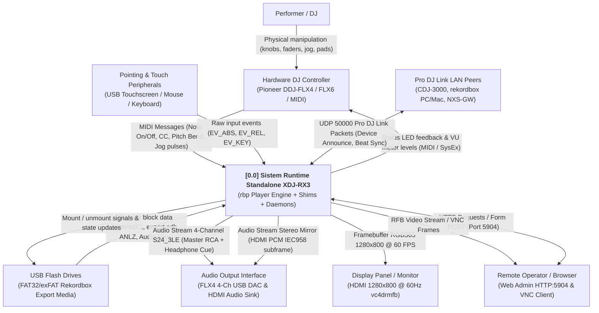
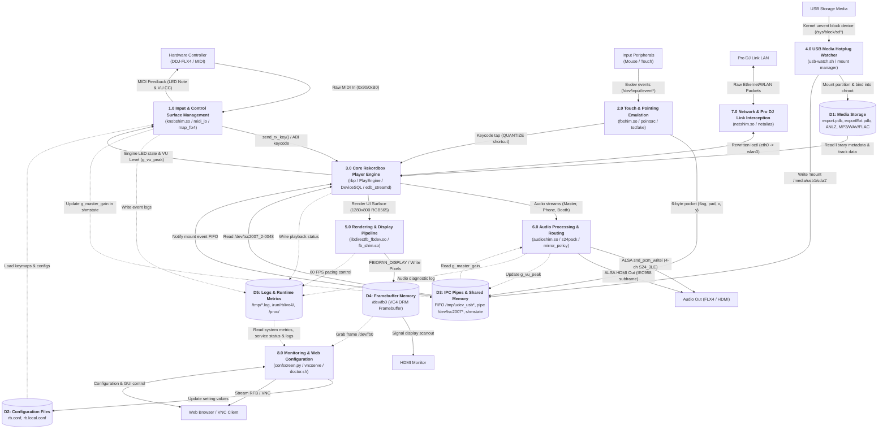
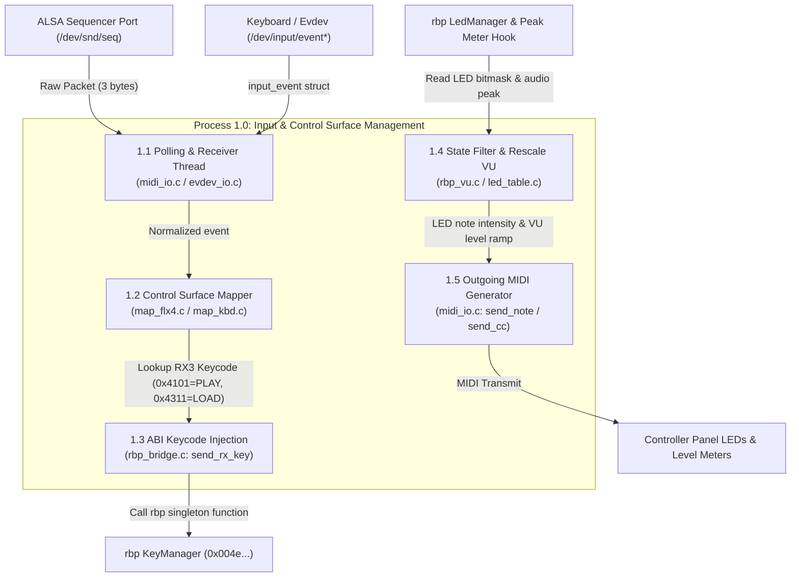
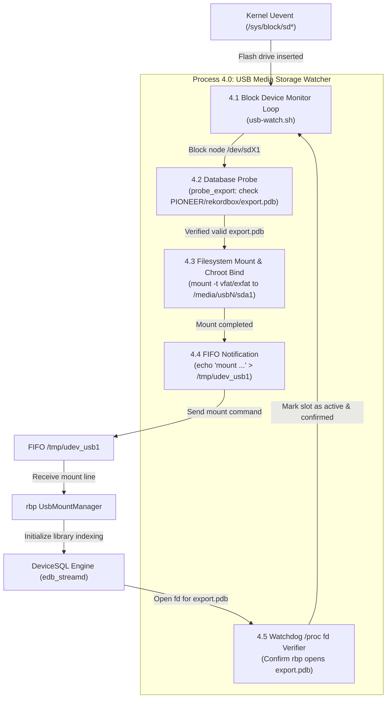
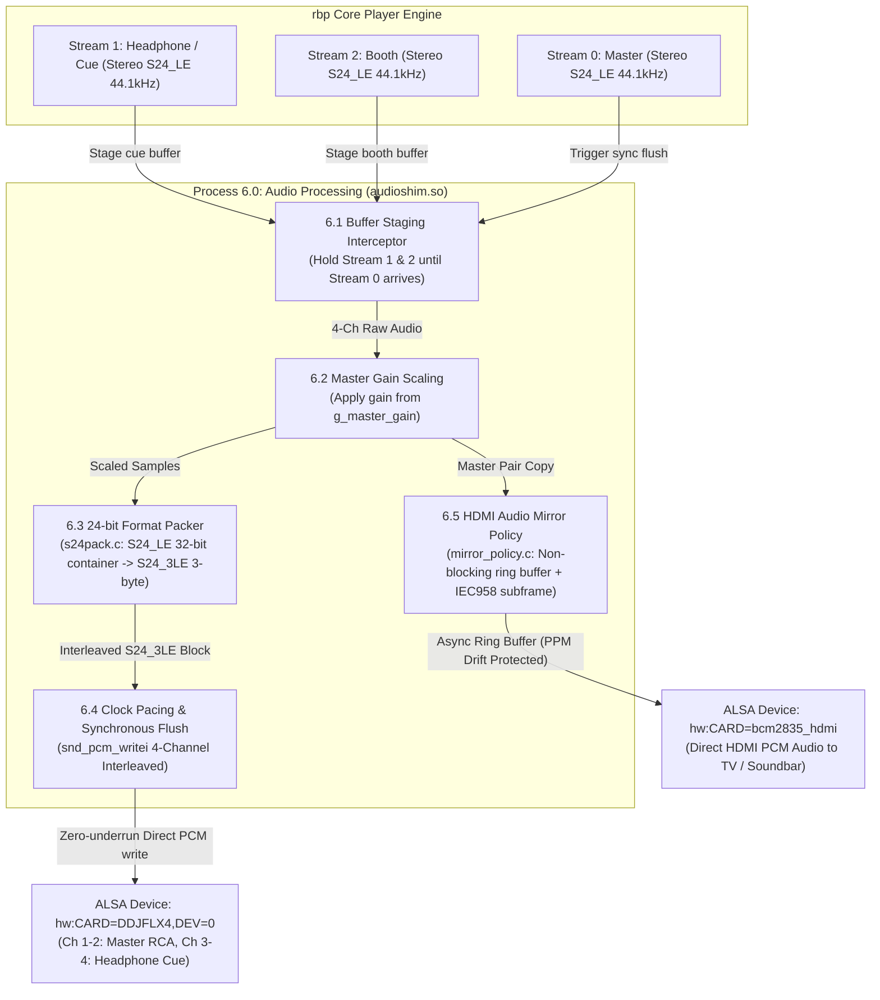
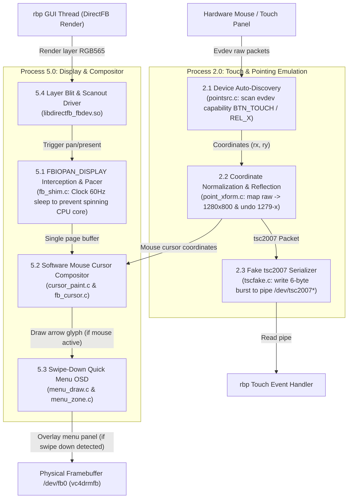

# 21 — Data Flow Diagram (DFD)

> *Versi Bahasa Indonesia: [21-dfd-dataflow-id.md](21-dfd-dataflow-id.md)*

Complete Data Flow Diagram (DFD) documentation for the Pioneer DJ XDJ-RX3 (`rbp`)
standalone player runtime on Raspberry Pi 4B / embedded Linux.

This document describes how data, control signals, audio streams, and user inputs
flow between the physical hardware, the kernel, the userland shims (`LD_PRELOAD`),
helper daemons, and the proprietary ARM32 soft-float `rbp` binary.

---

## 1. DFD Level 0: Context Diagram

The Context Diagram defines the system boundary for **Sistem Standalone Player XDJ-RX3**
and its interactions with external entities (performer, peripherals, storage, audio DAC,
display, network peers, and remote management).



---

## 2. DFD Level 1: System Decomposition

DFD Level 1 decomposes the system into 8 core functional processes and 5 persistent/ephemeral data stores:

*   **1.0 Input & Control Surface Management**: Translates MIDI and evdev inputs into `rbp` ABI keycodes, and generates LED/VU feedback.
*   **2.0 Touch & Pointing Emulation**: Discovers pointer devices, maps coordinates, and simulates the TI TSC2007 resistive touchscreen protocol.
*   **3.0 Core Rekordbox Player Engine**: The extracted XDJ-RX3 ARM32 soft-float player (`rbp`, `PlayEngine`, `DeviceSQL`, `edb_streamd`).
*   **4.0 USB Media Storage & Hotplug Watcher**: Detects USB insertions, validates rekordbox database presence, mounts, and alerts `rbp`.
*   **5.0 Rendering & Display Pipeline**: Interposes framebuffer ioctls, provides 60 Hz vblank pacing, and composites cursor/top-menu overlays.
*   **6.0 Audio Processing & Stream Routing**: Intercepts 3 stereo streams from `rbp`, packs 24-bit samples into 4-channel ALSA frames, and mirrors master to HDMI.
*   **7.0 Network & Pro DJ Link Interception**: Rewrites hardcoded `eth0` interface queries to active interfaces (`wlan0`).
*   **8.0 Monitoring, Web Config & Remote Access**: Provides web management UI (`confscreen.py`), VNC frame streaming (`vncserve`), and health checks.



---

## 3. DFD Level 2: Detailed Process Workflows

### 3.1 Process 1.0: Physical Controls & LED/VU Feedback Loop

Detailed data flow inside [ctrlshim.c](file:///p:/XDJ-Firmware/XDJ-RX3-Amlogic-S905X/scripts/shims/ctrlshim.c), [map_flx4.c](file:///p:/XDJ-Firmware/XDJ-RX3-Amlogic-S905X/scripts/shims/map_flx4.c), and [rbp_bridge.c](file:///p:/XDJ-Firmware/XDJ-RX3-Amlogic-S905X/scripts/shims/rbp_bridge.c).



---

### 3.2 Process 4.0: USB Hotplug & Rekordbox Database Ingestion

Detailed flow of [usb-watch.sh](file:///p:/XDJ-Firmware/XDJ-RX3-Amlogic-S905X/scripts/device/usb-watch.sh) handling media insertion and library attachment.



---

### 3.3 Process 6.0: Multi-Channel Audio Processing & HDMI Mirroring

Detailed flow inside [audioshim.c](file:///p:/XDJ-Firmware/XDJ-RX3-Amlogic-S905X/scripts/shims/audioshim.c), [s24pack.c](file:///p:/XDJ-Firmware/XDJ-RX3-Amlogic-S905X/scripts/shims/s24pack.c), and [mirror_policy.c](file:///p:/XDJ-Firmware/XDJ-RX3-Amlogic-S905X/scripts/shims/mirror_policy.c).



---

### 3.4 Process 2.0 & 5.0: Touch Input Emulation & Display Framebuffer Pipeline

Detailed flow between [pointsrc.c](file:///p:/XDJ-Firmware/XDJ-RX3-Amlogic-S905X/scripts/shims/pointsrc.c), [tscfake.c](file:///p:/XDJ-Firmware/XDJ-RX3-Amlogic-S905X/scripts/shims/tscfake.c), [fb_shim.c](file:///p:/XDJ-Firmware/XDJ-RX3-Amlogic-S905X/scripts/shims/fb_shim.c), and DirectFB.



---

## 4. Data Dictionary (Kamus Data)

| Data Element | Format / Specification | Source Process | Target Process | Description |
|---|---|---|---|---|
| **MIDI In Message** | 3-byte ALSA MIDI packet `[status, data1, data2]` | Hardware Controller | P1.1 `midi_io.c` | Physical controller events: buttons (Note On/Off), faders/knobs (CC), jog wheel relative movement. |
| **RX3 Keycode** | `uint32_t` (e.g., `0x4101` Play, `0x4311` Load) | P1.2 `map_flx4.c` | P1.3 `rbp_bridge.c` | Pioneer internal UI/transport keycode injected directly into `rbp`'s `KeyManager::send_rx_key()`. |
| **tsc2007 Packet** | 6-byte binary struct: `{u8 flag; u8 pad; u16 x; u16 y}` | P2.3 `tscfake.c` | P3.0 `rbp` UI Thread | Emulated packet of TI TSC2007 resistive touch controller fed into `/dev/tsc2007_2-0048`. |
| **USB Mount Line** | ASCII string: `"mount /media/usb1/sda1\n"` | P4.4 `usb-watch.sh` | P3.0 `rbp` `UsbMountManager` | Written to FIFO `/tmp/udev_usb1` to trigger device library mount in `rbp`. |
| **rekordbox DB** | DeviceSQL / SQLite binary format (`export.pdb`, `exportExt.pdb`) | D1 USB Media | P3.0 `edb_streamd` / `rbp` | Tracks, playlists, cue points, waveform peaks (`ANLZ`), and album art references. |
| **rbp Audio Period** | 32-bit container PCM Interleaved S24_LE (44.1 kHz, 64 frames) | P3.0 `rbp` Audio Engine | P6.1 `audioshim.c` | 3 distinct stereo streams: Stream 0 (Master), Stream 1 (Headphones/Cue), Stream 2 (Booth). |
| **FLX4 Audio Stream** | 24-bit packed PCM Interleaved S24_3LE (44.1 kHz, 4 channels) | P6.3 `s24pack.c` | ALSA USB Audio Driver | Physical 4-channel output: Ch 1-2 Master Out (RCA), Ch 3-4 Headphone Monitor (Jack 3.5mm). |
| **HDMI Mirror Stream** | IEC 60958 Subframe Audio (`IEC958_SUBFRAME_LE`) | P6.5 `mirror_policy.c` | ALSA VC4 HDMI Driver | Non-blocking master audio copy directed to HDMI sink, protected against clock drift (~155 ppm). |
| **Shared State (`shmstate`)** | Global C variables: `g_master_gain`, `g_vu_peak` | P1.0 `knobshim` / P6.0 `audioshim` | Inter-shim IPC | Bidirectional shared memory exchange: master volume knob gain and audio VU peak levels. |
| **Pro DJ Link Packet** | UDP Datagram Port 50000 (Magic: `Qspt1WmJOL`) | P7.0 `netshim.so` | External LAN Peers | Beatgrid synchronization, player status broadcast, and remote player link communication. |

---

## 5. Preload Ordering & Execution Hierarchy

The runtime enforces a strict `LD_PRELOAD` ordering in [scripts/shims/README.md](file:///p:/XDJ-Firmware/XDJ-RX3-Amlogic-S905X/scripts/shims/README.md):

```
LD_PRELOAD=/usr/lib/crashcatch.so:/usr/lib/netshim.so:/usr/lib/fbshim.so:/usr/lib/knobshim.so:/usr/lib/audioshim.so
```

1. **`crashcatch.so`** (First): Traps fatal signals (SIGSEGV/SIGBUS) and writes PC/LR registers to `/tmp/crash.log`.
2. **`netshim.so`** (Second, before `fbshim.so`): Both shims interpose `ioctl()`. `netshim` must intercept `eth0` queries first and delegate everything else via `dlsym(RTLD_NEXT)` to `fbshim.so`.
3. **`fbshim.so`** (Third): Interposes framebuffer ioctls, paces 60 FPS presentations, and creates fake `/dev/tsc2007_2-0048`.
4. **`knobshim.so`** (Fourth, before `audioshim.so`): Defines data symbols (`g_master_gain`) read by `audioshim.so`.
5. **`audioshim.so`** (Fifth): Defines data symbols (`g_vu_peak`) read back by `knobshim.so`.
