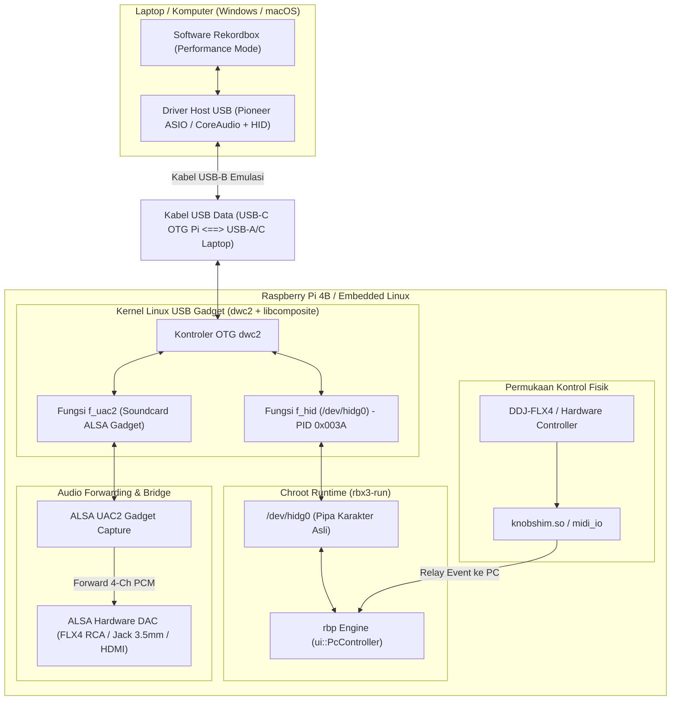

# 23 — Rencana Implementasi Mode USB HID / Rekordbox PC Connection (Roadmap & Technical Plan)

Dokumen ini memaparkan rencana teknis, arsitektur, dan tahapan implementasi (*implementation roadmap*) untuk mengaktifkan koneksi kabel **USB-B (PC Control / HID Mode)** dari sistem ini ke komputer/laptop yang menjalankan software **Pioneer DJ Rekordbox (Performance Mode)**, sehingga unit dapat berfungsi penuh layaknya **XDJ-RX3** komersial.

---

## 1. Latar Belakang & Tujuan (Objective)

### 1.1 Masalah Saat Ini
Saat ini, proyek **rbpi4b / XDJ-RX3 on Linux** beroperasi secara eksklusif dalam mode **Standalone Host**:
*   Raspberry Pi bertindak sebagai USB Host (menerima USB Flashdisk dan kontroler seperti DDJ-FLX4).
*   Komponen USB PC-controller internal pada `rbp` di-*stub* di [scripts/device/fix-dev.sh](file:///p:/XDJ-Firmware/XDJ-RX3-Amlogic-S905X/scripts/device/fix-dev.sh) (`mkfifo /dev/hidg0`, `rm -f /dev/paudiog0`).
*   Tidak ada kabel yang dapat dicolokkan ke laptop untuk mengendalikan software Rekordbox DJ.

### 1.2 Target Akhir (*End Goal*)
Ketika kabel USB dari port OTG Raspberry Pi dicolokkan ke port USB laptop (Windows / macOS):
1.  **Hardware Unlock Otomatis**: Software Rekordbox di laptop mendeteksi hardware sebagai **Pioneer DJ XDJ-RX3** asli (`VID: 0x2B73, PID: 0x003A`), sehingga mode **PERFORMANCE** langsung aktif tanpa perlu langganan berbayar (*Hardware Unlock Device*).
2.  **Soundcard USB ASIO / CoreAudio 4-Kanal**: Komputer mendeteksi antarmuka audio RX3 (Master Out Ch 1-2, Headphone Cue Ch 3-4, dan Rekaman Input Ch 1-2).
3.  **Kontrol HID Dua Arah (*Bidirectional HID*)**: Seluruh knob, fader, pad, jog wheel, dan tombol transport mengendalikan software Rekordbox secara instan dengan resolusi tinggi (bukan MIDI standar 7-bit).
4.  **Tampilan Layar & Waveform Rekordbox**: Layar HDMI menampilkan antarmuka dan waveform lagu yang sedang diputar di software Rekordbox PC (*PC Control Mode*).

---

## 2. Arsitektur Aliran Data (Architecture Overview)



---

## 3. Prasyarat Perangkat Keras & Solusi Topologi USB

### 3.1 Analisis Khusus: Board Amlogic S905X (Armbian) vs Raspberry Pi 4B

Pada board utama berbasis **Amlogic S905X** (seperti TV Box TX3 Mini, X96 Mini, LePotato / AML-S905X-CC, Khadas VIM1, dsb.), topologi USB berbeda signifikan dari Raspberry Pi:

*   **Pasokan Daya Independen**: Board S905X ditenagai melalui jack DC 5V/12V mandiri (bukan dari port USB). Masalah kekurangan daya USB-C seperti pada Pi 4 **tidak terjadi** di sini.
*   **Dual USB Controller pada SoC S905X (Meson GXL)**:
    1.  **USB Port 0 (OTG Dual-Role Controller - `dwc2`)**: Mampu beroperasi sebagai **Host** maupun **Peripheral / Device (Gadget)**. Pada sebagian besar board TV Box S905X, port ini dihubungkan langsung ke **satu colokan USB Type-A fisik** (port yang biasa dipakai untuk *Amlogic USB Burning Tool*).
    2.  **USB Port 1 (Host-Only Controller)**: Murni beroperasi sebagai **USB Host**.

---

### 3.2 Jawaban: Penggunaan USB HUB & Kabel USB-A to USB-A ke Laptop

> **Pertanyaan Kritis:**
> 1. *Apakah bisa menggunakan USB HUB untuk memperbanyak port?*
> 2. *Jika kabel USB-A to USB-A dicolokkan dari USB HUB ke Laptop, apakah bisa berfungsi untuk Rekordbox?*

#### ❌ Skenario yang TIDAK BISA: Kabel USB-A to USB-A dicolokkan ke USB HUB
*   **Alasan Teknis**: Chip IC pada USB HUB standar (seperti GL850G, FE1.1s, Realtek) bekerja dengan arsitektur 1 Upstream Port (ke Host) dan beberapa Downstream Facing Ports (DFP). 
*   Port downstream pada USB Hub **tidak memiliki kontroler UDC/OTG**. Port tersebut murni beroperasi sebagai Host.
*   Jika Anda menghubungkan kabel USB-A to USB-A dari colokan USB HUB ke Laptop:
    1.  **Tidak akan terdeteksi**: Laptop adalah Host, dan USB HUB downstream juga Host. Dua USB Host tidak dapat berkomunikasi tanpa ada peran Device/Slave.
    2.  **BAHAYA BENTURAN TEGANGAN (VBUS Conflict)**: Jalur +5V dari adaptor USB Hub/S905X akan terhubung langsung secara paralel dengan jalur +5V port USB laptop. Hal ini dapat memicu proteksi arus berlebih pada laptop atau merusak regulator motherboard!

#### ✅ Skenario yang BENAR & SANGAT MEMUNGKINKAN: Topologi 2-Port Independen S905X
Anda **BISA** menggunakan USB HUB untuk memperbanyak port periferal DJ, dan **BISA** menggunakan kabel USB-A to USB-A ke PC, dengan **aturan topologi wajib** berikut:

1.  **Port USB OTG S905X (Port 0)**: Dihubungkan **LANGSUNG** ke Laptop menggunakan kabel **USB-A to USB-A** (dengan modifikasi VBUS). Port inilah yang mengemulasikan XDJ-RX3 Gadget ke Rekordbox.
2.  **Port USB Host S905X (Port 1)**: Dicolokkan ke **USB HUB** (4-port / 7-port). USB HUB ini menampung seluruh periferal input:
    *   Pioneer DDJ-FLX6 / DDJ-FLX4 (Kontroler DJ)
    *   Flashdisk Rekordbox (Media Penyimpanan)
    *   Mouse / Keyboard / Layar Sentuh Capacitive (CTP)

```
[Laptop / Komputer PC]
   (Rekordbox DJ)
          │
          │ Kabel USB-A to USB-A (Pin VBUS 5V Diisolasi/Putus)
          ▼
┌────────────────────────────────────────────────────────┐
│               Board Amlogic S905X                      │
│        (Ditenagai Adaptor DC 5V/12V Mandiri)           │
│                                                        │
│ [Port USB OTG S905X]  ──> dr_mode = "peripheral"       │
│                           (Emulasi XDJ-RX3: HID+UAC2)  │
│                                                        │
│ [Port USB Host S905X] ──> dr_mode = "host"             │
└───────────────────────────┬────────────────────────────┘
                            │
                            ▼
                   ┌─────────────────┐
                   │   USB 2.0 HUB   │ (Ekspansi 4 Port)
                   └──┬─────┬─────┬──┘
                      │     │     │
                      ▼     ▼     ▼
                   [DDJ-  [USB  [Touch/
                   FLX6] Stick] Mouse]
```

---

### 3.3 Prosedur Wajib: Isolasi VBUS pada Kabel USB-A to USB-A

Karena board Amlogic S905X sudah memiliki sumber daya DC sendiri dan laptop juga mengeluarkan daya +5V pada port USB-nya, Anda **wajib memutus jalur daya 5V** pada kabel USB-A to USB-A:

*   **Metode Tape Mod (Tanpa Memotong Kabel)**:
    1.  Lihat kepala colokan USB-A jantan (*male*). Terdapat 4 pin tembaga: `Pin 1 (+5V VBUS)`, `Pin 2 (D-)`, `Pin 3 (D+)`, `Pin 4 (GND)`.
    2.  Gunting selotip/isolasi kertas tipis berukuran ~1 mm.
    3.  Tempelkan isolasi tersebut secara presisi di atas **Pin 1 (pin paling luar kiri/kanan jalur +5V)** pada salah satu ujung colokan kabel USB-A.
    4.  Pastikan pin D-, D+, dan GND tetap terbuka dan bersentuhan dengan soket.
*   **Metode Kabel Data-Only**: Jika membuat kabel sendiri, sambungkan hanya 3 kawat: **Putih (D-)**, **Hijau (D+)**, dan **Hitam (GND)**. Jangan sambungkan kawat Merah (+5V).

---

### 3.4 Untuk Pengguna Raspberry Pi 4B (Referensi Tambahan)
Bagi pengguna Raspberry Pi 4B:
*   Port USB-C adalah satu-satunya port yang terhubung ke kontroler OTG SoC (`dwc2`).
*   Gunakan **USB-C Data/Power Y-Splitter** (Jalur daya ke adaptor 5V 3A resmi, jalur data D+/D-/GND ke laptop) atau beri daya via Pin GPIO 5V (Pin 2/4 & Pin 6).

---

## 4. Tahapan Implementasi Teknis (Step-by-Step Implementation)

### Tahap 1: Konfigurasi Kernel Driver OTG Linux

#### A. Pada Board Amlogic S905X (Armbian / Linux Mainline):
Pada Amlogic S905X, kontroler OTG DWC2 dikenali pada alamat memori platform `c9000000.usb` atau node `&usb0`:

1.  Muat modul kernel USB Gadget:
    ```bash
    sudo modprobe dwc2
    sudo modprobe libcomposite
    ```
2.  Pastikan port USB 0 beralih ke mode peripheral. Tambahkan baris ini pada script startup atau file device tree overlay Armbian (`/boot/armbianEnv.txt`):
    ```
    overlays=usb-otg
    ```
    Atau atur langsung melalui sysfs:
    ```bash
    echo peripheral > /sys/devices/platform/soc/c9000000.usb/dr_mode 2>/dev/null || true
    ```
3.  Verifikasi bahwa kontroler UDC muncul di sistem:
    ```bash
    ls /sys/class/udc
    # Output yang benar: c9000000.usb (pada S905X) atau dwc2
    ```

#### B. Pada Raspberry Pi 4B (Pi OS):
1.  Tambahkan parameter di `/boot/firmware/config.txt`:
    ```ini
    dtoverlay=dwc2,dr_mode=peripheral
    ```
2.  Tambahkan modul kernel pada `/etc/modules`:
    ```
    dwc2
    libcomposite
    ```

---

### Tahap 2: Pembentukan USB Composite Gadget Pioneer XDJ-RX3
Membuat script shell ConfigFS (`scripts/device/gadget-xdjrx3.sh`) untuk mendaftarkan identitas USB resmi Pioneer XDJ-RX3:

```bash
#!/bin/bash
# scripts/device/gadget-xdjrx3.sh — Inisialisasi USB Gadget Pioneer XDJ-RX3

CONFIGFS_ROOT="/sys/kernel/config/usb_gadget"
GADGET_NAME="xdjrx3"
G_DIR="$CONFIGFS_ROOT/$GADGET_NAME"

# Muat modul
modprobe libcomposite 2>/dev/null

mkdir -p "$G_DIR"
cd "$G_DIR"

# 1. Identitas Hardware Pioneer XDJ-RX3 (Penting untuk Hardware Unlock Rekordbox)
echo 0x2b73 > idVendor      # Pioneer DJ Corporation / AlphaTheta
echo 0x003a > idProduct     # XDJ-RX3 Product ID
echo 0x0120 > bcdDevice     # Versi Firmware 1.20
echo 0x0200 > bcdUSB        # USB 2.0 High-Speed

# 2. String Descriptors
mkdir -p strings/0x409
echo "PIONEER-RX3-0001"            > strings/0x409/serialnumber
echo "Pioneer DJ Corporation"     > strings/0x409/manufacturer
echo "XDJ-RX3"                    > strings/0x409/product

# 3. Fungsi 1: USB HID Interface (f_hid)
mkdir -p functions/hid.usb0
echo 0 > functions/hid.usb0/subclass
echo 0 > functions/hid.usb0/protocol
echo 64 > functions/hid.usb0/report_length
# Masukkan binary Pioneer XDJ-RX3 HID Report Descriptor ke report_desc
cat /opt/rblive4/assets/rx3_hid_report_desc.bin > functions/hid.usb0/report_desc

# 4. Fungsi 2: USB Audio Class 2.0 (f_uac2)
mkdir -p functions/uac2.usb0
echo 4 > functions/uac2.usb0/c_chmask      # 4 Kanal Playback dari Laptop
echo 2 > functions/uac2.usb0/p_chmask      # 2 Kanal Capture (Recording) ke Laptop
echo 44100 > functions/uac2.usb0/c_srate   # 44.1 kHz
echo 44100 > functions/uac2.usb0/p_srate
echo 3 > functions/uac2.usb0/c_ssize       # 24-bit audio (3 bytes)

# 5. Konfigurasi Endpoint & Hubungkan ke UDC Controller
mkdir -p configs/c.1/strings/0x409
echo "XDJ-RX3 Composite Device" > configs/c.1/strings/0x409/configuration
echo 500 > configs/c.1/MaxPower

ln -s functions/hid.usb0 configs/c.1/
ln -s functions/uac2.usb0 configs/c.1/

# Ikat ke UDC
UDC_NAME=$(ls /sys/class/udc | head -n 1)
echo "$UDC_NAME" > UDC

echo "gadget-xdjrx3: USB Gadget XDJ-RX3 aktif pada kontroler $UDC_NAME"
```

---

### Tahap 3: Integrasi Node `/dev/hidg0` ke Dalam Chroot `rbp`
Pada file [scripts/device/fix-dev.sh](file:///p:/XDJ-Firmware/XDJ-RX3-Amlogic-S905X/scripts/device/fix-dev.sh), ubah penanganan `/dev/hidg0`:
*   Sebelumnya: Dibuat sebagai FIFO kosong (`mkfifo $RB_CHROOT/dev/hidg0`).
*   Perubahan: Jika `/dev/hidg0` asli ada dari kernel USB Gadget, lakukan bind-mount atau link node karakter tersebut ke chroot agar `rbp` dapat membaca dan menulis paket HID mentah langsung ke software Rekordbox di PC.

---

### Tahap 4: Aktivasi Gate `ui::PcController::isUsbBConnected()`
Berdasarkan temuan di [docs/18-prodjlink.md](file:///p:/XDJ-Firmware/XDJ-RX3-Amlogic-S905X/docs/18-prodjlink.md#L427-L435) dan [scripts/patch-rbp-nopc.py](file:///p:/XDJ-Firmware/XDJ-RX3-Amlogic-S905X/scripts/patch-rbp-nopc.py):
1.  Biner `rbp` sudah memiliki logika deteksi USB-B bawaan yang dipantau setiap detik oleh `NetworkMonitor::timerCallback()`.
2.  Saat kabel USB dicolokkan ke PC (dideteksi via event kernel `udev` pada antarmuka gadget), kirimkan string perintah `"connect"` ke FIFO `/tmp/udev_usb1`:
    ```bash
    echo "connect" > /tmp/udev_usb1
    ```
3.  Perintah ini memicu `ui::PcController::handleUsbMountMessage` (Message ID 3), yang akan menulis nilai `1` ke alamat register state `PcController+0x72`.
4.  Hasilnya: `rbp` beralih ke mode PC Connection, dan antarmuka layar akan memunculkan status koneksi Rekordbox.

---

### Tahap 5: Ruting Aliran Audio (Rekordbox PC -> DAC Fisik)
Saat laptop memutar lagu di Rekordbox Performance Mode:
1.  Audio dialirkan oleh laptop ke kartu suara USB Gadget (`UAC2Gadget`).
2.  Di sisi Linux, stream ini ditangkap melalui ALSA capture:
    ```
    hw:CARD=UAC2Gadget,DEV=0
    ```
3.  Audio diarahkan secara real-time ke DAC fisik (DDJ-FLX4 atau HDMI) menggunakan modul forwarding latensi ultra-rendah (ALSA loopback / `alsaloop` dengan buffer period 64 frame):
    ```bash
    alsaloop -C hw:CARD=UAC2Gadget,DEV=0 -P hw:CARD=DDJFLX4,DEV=0 -t 50000 -f S24_3LE -r 44100 -c 4 -b
    ```
    *   **Kanal 1 & 2**: Keluar ke Speaker Master (RCA).
    *   **Kanal 3 & 4**: Keluar ke Headphone DJ (Jack 3.5mm untuk Cue/PFL).

---

## 5. Matriks Pengujian & Milestone (Verification Roadmap)

| Milestone | Target Drill | Metode Pengujian | Indikator Sukses |
|---|---|---|---|
| **M1.0** | Inisialisasi UDC & ConfigFS | Jalankan `gadget-xdjrx3.sh` pada Pi 4 | Muncul node `/dev/hidg0` dan kartu suara `/proc/asound/cards` bernama `UAC2Gadget`. |
| **M2.0** | Enumerasi USB pada Laptop | Sambungkan kabel USB-C ke Laptop Windows / Mac | Perintah `lsusb` (Linux/Mac) atau Device Manager (Windows) mengenali perangkat `2b73:003a "Pioneer DJ XDJ-RX3"`. |
| **M3.0** | **Rekordbox Hardware Unlock** | Buka software Rekordbox 6 / 7 di Laptop | Rekordbox otomatis mengaktifkan mode **PERFORMANCE** tanpa meminta aktivasi lisensi berlangganan. |
| **M4.0** | Ruting Audio 4-Channel | Putar audio dari Rekordbox PC | Audio Master terdengar jernih dari speaker RCA, dan tombol CUE mengalirkan audio monitor ke headphone. |
| **M5.0** | Komunikasi Kontrol HID | Gerakkan jog wheel atau tekan tombol Play/Cue pada controller | Software Rekordbox di laptop merespons putaran jog wheel, pitch fader, dan hot cue secara instan tanpa lag. |
| **M6.0** | Sinkronisasi GUI & Waveform | Masuk ke mode PC Control pada UI `rbp` | Layar monitor HDMI menampilkan data track dan waveform yang dialirkan dari software Rekordbox laptop. |

---

## 6. Kesimpulan & Rekomendasi
Mengaktifkan mode USB HID ke software Rekordbox PC sepenuhnya **layak secara teknis (*technically feasible*)** karena biner `rbp` XDJ-RX3 v1.20 sudah memuat kode sumber `PcController` dan handler HID secara lengkap. 

Tantangan utama terletak pada penyiapan **USB-C OTG Y-splitter** untuk pasokan daya yang aman, penyusunan **USB HID Descriptor** resmi RX3 pada ConfigFS Linux, serta bridging paket data antara node `/dev/hidg0` dan biner `rbp`.
