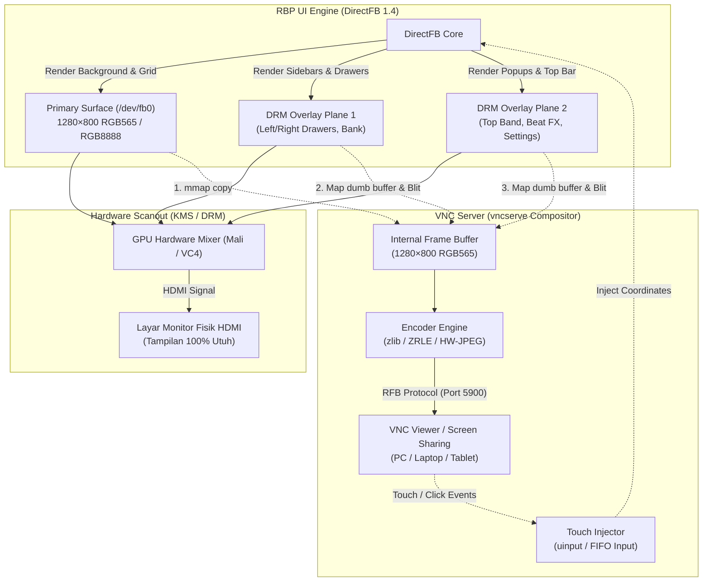

# 24 — Arsitektur Rendering UI RBP & VNC Compositor

Dokumen ini mendokumentasikan arsitektur grafis sistem **XDJ-RX3 (`rbp`)** dan bagaimana server **VNC (`vncserve`)** menggabungkan (*composite*) seluruh layer UI menjadi satu tampilan utuh secara real-time.

---

## 1. Ringkasan Eksekutif

> **Pertanyaan Inti:** *Apakah penampilan UI RBP dan VNC menggunakan layering atau kanvas tunggal?*

**Jawabannya:** **Ya, sistem ini 100% menggunakan arsitektur Multi-Plane Hardware Layering (DRM Overlay Planes) yang dikomposisikan ulang oleh VNC.**

UI RBP **tidak pernah digambar ke dalam satu buffer tunggal**. Elemen antarmuka dipisahkan ke dalam beberapa bidang (*planes*) hardware independen oleh DirectFB dan kernel DRM:
* Jika suatu program hanya membaca `/dev/fb0`, layar akan tampak **"ompong"** (drawer samping, header atas, dan menu popup hilang).
* GPU/Display Controller menggabungkan (*scanout composition*) layer-layer tersebut langsung pada sinyal HDMI monitor fisik.
* Server VNC (`vncserve`) bertindak sebagai **software compositor**, membaca `/dev/fb0` dan seluruh DRM overlay plane yang aktif, lalu menimpa (*blitting*) semuanya ke satu kanvas 1280×800 sebelum dikirim ke jaringan.

---

## 2. Diagram Alur Rendering UI & VNC



---

## 3. Rincian Layering pada RBP

### Layer 0 — Primary Framebuffer (`/dev/fb0`)
* **Pengelola:** Driver Framebuffer Linux (`mesondrmfb` di S905X / `vc4drmfb` di Pi4).
* **Format:** 1280×800, 16-bit (RGB565) atau 32-bit (ARGB8888), stride 2560 B (pada 16 bpp) atau 5120 B (pada 32 bpp).
* **Konten:**
  - Latar belakang utama (background wallpaper & border).
  - Tampilan daftar lagu (*Track Browse List*).
  - Waveform ringkasan statis (overview wave).
  - Grid deck dasar.

### Layer 1, 2, dst. — Hardware DRM Overlay Planes (`/dev/dri/card*`)
RBP memanfaatkan fitur *DirectFB Multi-Layer System* yang langsung meminta alokasi hardware plane independen ke kernel DRM (`DRM_IOCTL_MODE_SETPLANE`):
* **Top Band (Header Bar):**
  Menampilkan jam, status Pro DJ Link, ikon media USB, master tempo, dan tombol selector sumber (SOURCE).
* **Side Drawers (Laci Samping Kiri & Kanan):**
  Panel shortcut, playlist bank, tag list, dan track filter. Panel ini bisa membuka dan menutup dengan animasi tanpa menggambar ulang background `/dev/fb0`.
* **Popups & Dialogs:**
  Panel konfigurasi *UTILITY / SHORTCUT*, pemilih channel *Beat FX*, dan pesan peringatan media.
* **Karakteristik Buffer:**
  - Format overlay adalah **opaque** (tidak menggunakan alpha blending yang berat).
  - Menggunakan *single-buffered dumb buffers* di VRAM GPU.
  - Koordinat posisi (*placement properties*) dikontrol via driver KMS.

---

## 4. Cara Kerja VNC Server (`vncserve`)

Karena separuh antarmuka berada di luar `/dev/fb0`, VNC server konvensional tidak dapat digunakan. `vncserve` dirancang secara khusus untuk bekerja dengan pipeline kompositor sebagai berikut:

### Tahap 1: Memetakan Layar Dasar
Server membaca memori `/dev/fb0` menggunakan panggilan sistem `mmap` (bukan `read()`, untuk menghemat latensi hingga < 9.5 ms):
```c
memcpy(dst_frame, fb0_mmap_ptr, frame_size);
```

### Tahap 2: Menemukan Plane DRM Aktif
Server membuka node DRM `/dev/dri/card1` (atau `card0`), mengaktifkan kapabilitas universal planes:
```c
drmSetClientCap(drm_fd, DRM_CLIENT_CAP_UNIVERSAL_PLANES, 1);
```
Server mengiterasi setiap plane yang memiliki `crtc_id != 0` dan `fb_id != 0`.

### Tahap 3: Blitting dan Komposisi Software
Untuk setiap plane overlay yang aktif:
1. Mengambil informasi dumb buffer melalui `drmModeGetFB(drm_fd, fb_id)`.
2. Memetakan memory plane ke ruang memori pengguna via `DRM_IOCTL_MODE_MAP_DUMB`.
3. Menimpa (*opaque memory copy blit*) pixel plane ke atas buffer tujuan pada koordinat `(x, y)` aslinya:
```c
vnc_compose_blit(dst_frame, dst_w, dst_h, plane_buffer, plane_rect);
```

Hasil akhir dari Tahap 3 adalah satu frame berukuran tepat **1280×800** yang merepresentasikan visual 100% identik dengan output HDMI fisik.

### Tahap 4: Kompresi dan Pengiriman Jaringan
* **Protokol:** RFB 3.3 / 3.8 pada port TCP `5900`.
* **Encoding Kompresi:**
  - **`zlib` / `ZRLE` (Encoding 6 / 16):** Kompresi lossless dengan efisiensi tinggi (~1.7 Mbit/s pada 4 FPS), kompatibel bawaan dengan macOS Screen Sharing dan VNC Viewer standar.
  - **`hwjpeg`:** Kompresi menggunakan akselerator hardware JPEG V4L2 encoder (`/dev/video11` / `/dev/video31`).

---

## 5. Interaksi Sentuh Dua Arah (Two-Way Touch)

Selain menayangkan video, sistem ini mendukung kendali sentuh interaktif penuh dari client VNC:

1. Pengguna menyentuh/mengklik layar pada VNC Viewer di laptop/iPad.
2. VNC Viewer mengirim paket RFB `PointerEvent` yang berisi koordinat `(x, y)` dan status tombol (tekan/lepas).
3. `vncserve` memetakan koordinat tersebut ke resolusi native RBP (1280×800).
4. Sinyal sentuhan diinjeksikan langsung ke dalam subsistem input RBP melalui emulasi `/dev/uinput` atau FIFO pointer.
5. RBP merespons sentuhan tersebut persis seolah-olah pengguna menyentuh panel layar sentuh fisik pada unit.

---

## 6. Ringkasan Perbedaan Komponen

| Komponen | Output Fisik HDMI | Capture `/dev/fb0` Biasa | `vncserve` (Sistem Ini) |
|---|---|---|---|
| **Background & Grid** | Ada | Ada | Ada |
| **Track List & Waveform** | Ada | Ada | Ada |
| **Top Band (Header/Jam)** | Ada | **HILANG** | Ada (via DRM Compositing) |
| **Side Drawers (Laci Menu)** | Ada | **HILANG** | Ada (via DRM Compositing) |
| **Beat FX / Settings Popup** | Ada | **HILANG** | Ada (via DRM Compositing) |
| **Interaksi Sentuh** | Panel Sentuh Fisik | Tidak Ada | Ada (Injeksi RFB Pointer) |

---
*Dokumen ini merupakan bagian dari repositori firmware XDJ-RX3 / Amlogic S905X & Pi4B.*
